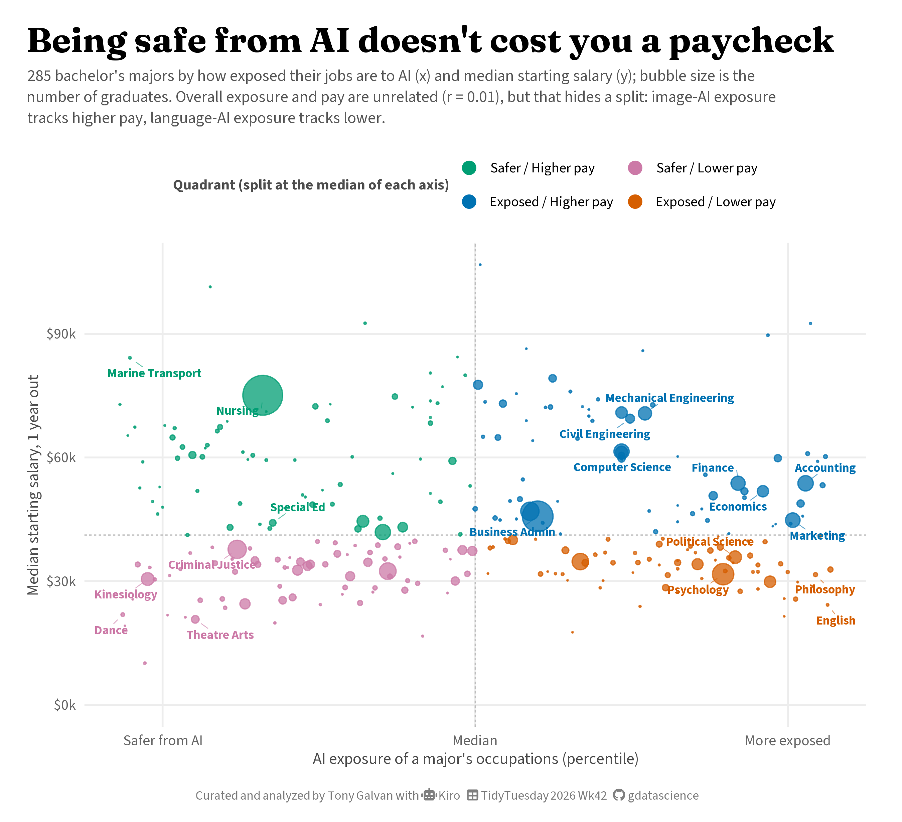
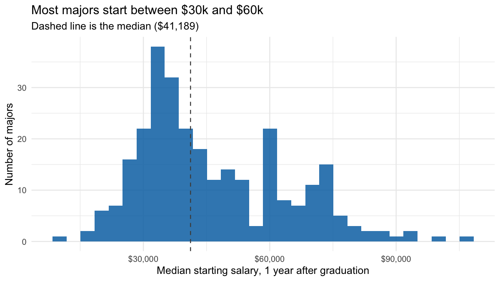
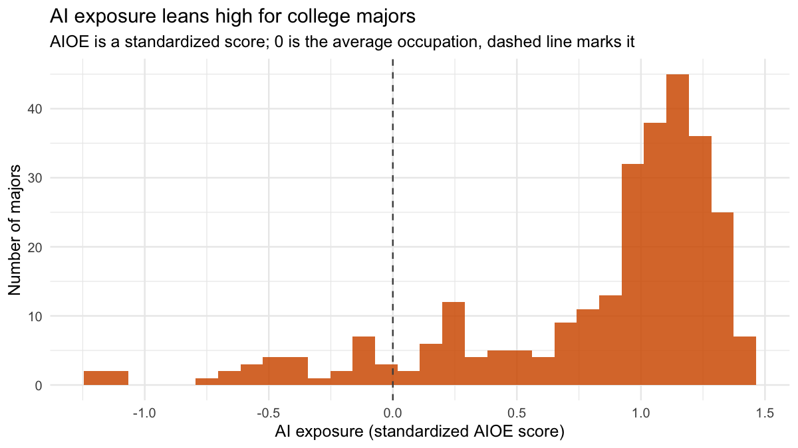
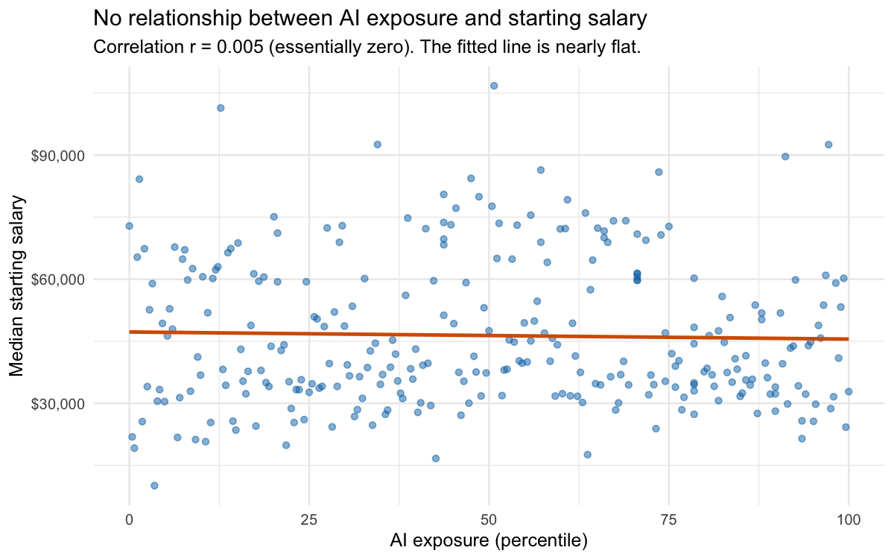
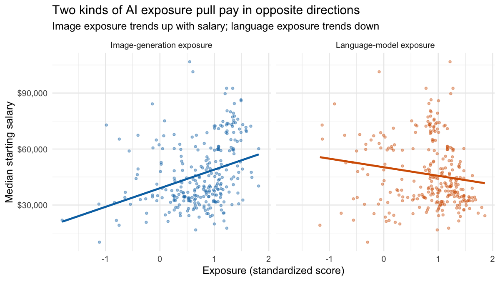
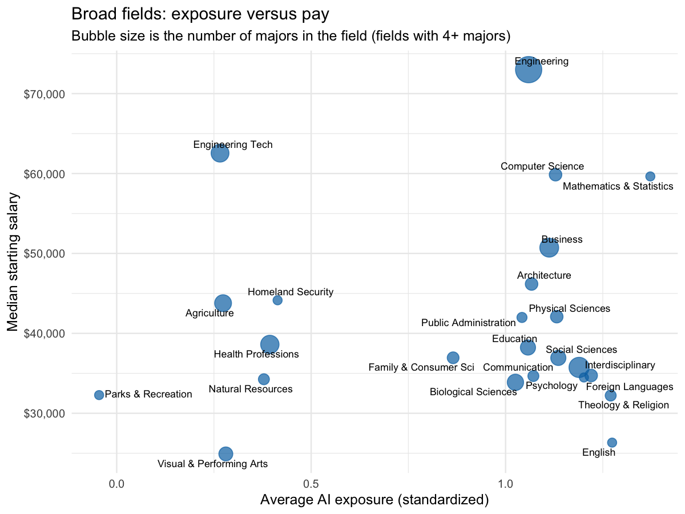
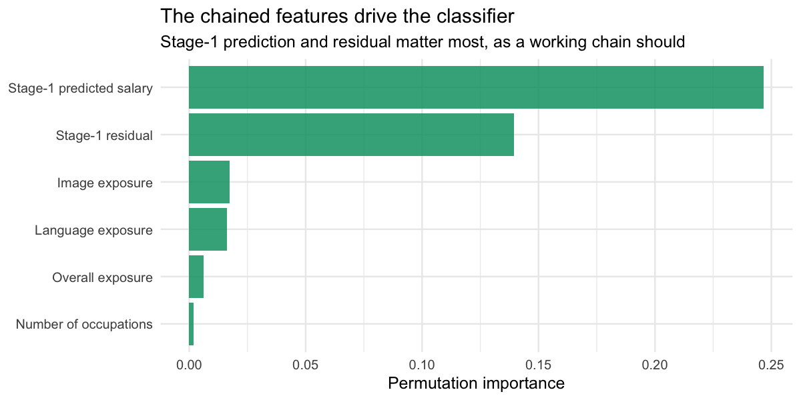

# Being Safe From AI Doesn't Cost You a Paycheck

**[Source Code](2026_10_20_tidy_tuesday_ai_majors.Rmd)** | Data from the [TidyTuesday project](https://github.com/rfordatascience/tidytuesday/tree/main/data/2026/2026-10-20) (Week 42, 2026-10-20)



I curated this week's TidyTuesday dataset with Kiro, then used it to ask whether the college majors safest from AI also pay the least. Across 285 majors, AI exposure and starting salary are basically unrelated (r = 0.01), but that flat headline hides a split: image-AI exposure tracks higher pay while language-AI exposure tracks lower. Built with k-means clustering and a chained two-stage ensemble model.

---

This week’s TidyTuesday dataset is one I curated myself, with a lot of
help from [Kiro](https://kiro.dev), the AI coding assistant I used to
find the sources, join them, write the cleaning script, and run the
analysis you’re reading now. The question behind it is one a lot of
students and career-changers are asking: **which college majors are
safest from AI, and do the safe ones actually pay?**

The short answer surprised me. Across 285 bachelor’s majors, how exposed
a major’s jobs are to AI has almost nothing to do with what those jobs
pay. The correlation is basically zero. But that flat headline hides a
more interesting story once you split AI exposure into the kind that
writes and the kind that draws. Let’s dig in.

## Where the data comes from

The dataset joins three public sources at the level of the college
major:

- **Starting salaries** from the U.S. Department of Education’s [College
  Scorecard](https://collegescorecard.ed.gov/data/), using median
  earnings one year after graduation for bachelor’s degrees.
- **AI exposure** from the [AI Occupational Exposure (AIOE)
  index](https://github.com/AIOE-Data/AIOE) of Felten, Raj and Seamans
  (2021), which scores how much each occupation’s abilities overlap with
  what AI can do, including separate scores for language tasks and image
  tasks.
- A [CIP-to-SOC
  crosswalk](https://nces.ed.gov/ipeds/cipcode/resources.aspx) from NCES
  and BLS that connects fields of study to the occupations their
  graduates enter.

A quick note on the exposure score, because it matters for everything
below. The AIOE is a [standardized
score](https://en.wikipedia.org/wiki/Standard_score) (statisticians call
it a z-score): it is centered so the average occupation is 0, and the
units are standard deviations. A value of +1 means “one standard
deviation more exposed than average.” Higher means more of the job’s
abilities overlap with AI. It does **not** mean the job will be
automated away. High exposure can just as easily mean AI assists the
work. To keep things readable, the dataset also carries
`ai_exposure_percentile`, a plain 0-to-100 rank.

``` r
library(tidyverse)
library(tidytuesdayR)
library(scales)
library(patchwork)
theme_set(theme_minimal(base_size = 12))
```

``` r
tt <- tt_load("2026-10-20")
majors <- tt$ai_salary_majors
occupations <- tt$major_occupations
```

## A first look at the data

Before telling any story, let’s profile what we have. The main table is
one row per major, with a starting salary and three flavors of AI
exposure.

``` r
glimpse(majors)
```

    ## Rows: 285
    ## Columns: 13
    ## $ cip4                   <chr> "4604", "5003", "4807", "4703", "4903", "4701",…
    ## $ field_of_study         <chr> "Building/Construction Finishing, Management, a…
    ## $ broad_field            <chr> "Construction Trades", "Visual and Performing A…
    ## $ broad_field_short      <chr> "Construction Trades", "Visual & Performing Art…
    ## $ median_starting_salary <dbl> 72864, 21878, 19151, 65331, 84187, 25583, 67372…
    ## $ median_salary_4yr      <dbl> 90691, 39716, 37055, 83528, 117176, NA, 82019, …
    ## $ ai_exposure            <dbl> -1.201, -1.162, -1.101, -1.091, -0.736, -0.684,…
    ## $ ai_exposure_percentile <dbl> 0.0, 0.4, 0.7, 1.1, 1.4, 1.8, 2.1, 2.5, 2.8, 3.…
    ## $ ai_exposure_language   <dbl> -1.133, -0.557, -1.174, -1.129, -0.905, -0.783,…
    ## $ ai_exposure_image      <dbl> -0.984, -1.796, -0.750, -0.746, -0.139, -0.245,…
    ## $ n_occupations          <dbl> 21, 3, 6, 9, 4, 12, 18, 3, 1, 6, 1, 6, 1, 2, 12…
    ## $ n_institutions         <dbl> 4, 62, 1, 1, 7, 1, 4, 49, 3, 10, 6, 548, 10, 6,…
    ## $ n_graduates            <dbl> 206, 1798, 24, 25, 632, 20, 187, 3905, 155, 312…

``` r
cat("Majors:", nrow(majors), "\n")
```

    ## Majors: 285

``` r
cat("Columns:", ncol(majors), "\n")
```

    ## Columns: 13

``` r
cat("Starting salary range: $", format(min(majors$median_starting_salary), big.mark = ","),
    " to $", format(max(majors$median_starting_salary), big.mark = ","), "\n", sep = "")
```

    ## Starting salary range: $10,084 to $106,754

Missing values are rare. Only the four-year salary column has gaps (a
handful of majors that don’t have a four-year earnings follow-up yet).

``` r
colSums(is.na(majors)) |> enframe("column", "n_missing") |> filter(n_missing > 0)
```

    ## # A tibble: 1 × 2
    ##   column            n_missing
    ##   <chr>                 <dbl>
    ## 1 median_salary_4yr         8

### How starting salaries are distributed

Most majors start somewhere between \$30k and \$60k, with a long tail of
higher-paying technical fields.

``` r
ggplot(majors, aes(median_starting_salary)) +
  geom_histogram(bins = 30, fill = "#0072B2", alpha = 0.85) +
  geom_vline(xintercept = median(majors$median_starting_salary),
             linetype = "dashed", color = "gray30") +
  scale_x_continuous(labels = label_dollar()) +
  labs(
    title = "Most majors start between $30k and $60k",
    subtitle = paste0("Dashed line is the median ($",
                      format(median(majors$median_starting_salary), big.mark = ","), ")"),
    x = "Median starting salary, 1 year after graduation", y = "Number of majors"
  )
```

<!-- -->

### How AI exposure is distributed

The exposure scores lean high and to the left-skewed side. That is
expected: the AIOE universe includes many occupations, and the ones that
college graduates enter tend to be information-heavy, which is exactly
what current AI touches most. The percentile version spreads majors
evenly from 0 to 100 by construction, so we’ll lean on it for plotting.

``` r
ggplot(majors, aes(ai_exposure)) +
  geom_histogram(bins = 30, fill = "#D55E00", alpha = 0.85) +
  geom_vline(xintercept = 0, linetype = "dashed", color = "gray30") +
  labs(
    title = "AI exposure leans high for college majors",
    subtitle = "AIOE is a standardized score; 0 is the average occupation, dashed line marks it",
    x = "AI exposure (standardized AIOE score)", y = "Number of majors"
  )
```

<!-- -->

### The headline: exposure and pay barely relate

Here is the result that started the whole analysis. If you plot AI
exposure against starting salary, the cloud is a shapeless blob. The
correlation is about 0.01, which is statistically indistinguishable from
no relationship at all.

``` r
r_overall <- cor(majors$ai_exposure, majors$median_starting_salary)

ggplot(majors, aes(ai_exposure_percentile, median_starting_salary)) +
  geom_point(alpha = 0.5, color = "#0072B2") +
  geom_smooth(method = "lm", se = FALSE, color = "#D55E00") +
  scale_y_continuous(labels = label_dollar()) +
  labs(
    title = "No relationship between AI exposure and starting salary",
    subtitle = paste0("Correlation r = ", round(r_overall, 3),
                      " (essentially zero). The fitted line is nearly flat."),
    x = "AI exposure (percentile)", y = "Median starting salary"
  )
```

<!-- -->

### The twist hiding inside the flat line

The AIOE comes in two generative-AI flavors: exposure to **language**
models (text tasks, the ChatGPT kind) and exposure to **image**
generation (visual tasks). When we correlate each of those with salary
separately, they point in *opposite* directions.

``` r
majors |>
  summarise(
    `Overall exposure`  = cor(ai_exposure, median_starting_salary),
    `Language exposure` = cor(ai_exposure_language, median_starting_salary),
    `Image exposure`    = cor(ai_exposure_image, median_starting_salary)
  ) |>
  pivot_longer(everything(), names_to = "Exposure type", values_to = "Correlation with salary") |>
  mutate(`Correlation with salary` = round(`Correlation with salary`, 3))
```

    ## # A tibble: 3 × 2
    ##   `Exposure type`   `Correlation with salary`
    ##   <chr>                                 <dbl>
    ## 1 Overall exposure                      0.005
    ## 2 Language exposure                    -0.155
    ## 3 Image exposure                        0.331

Image-generation exposure is *positively* tied to pay, while
language-model exposure is *negatively* tied to it. The two forces
roughly cancel, which is why the overall number looked like nothing.
Plotting both makes the split obvious.

``` r
majors |>
  select(median_starting_salary, ai_exposure_language, ai_exposure_image) |>
  pivot_longer(starts_with("ai_exposure"),
               names_to = "type", values_to = "exposure") |>
  mutate(type = recode(type,
                       ai_exposure_language = "Language-model exposure",
                       ai_exposure_image = "Image-generation exposure")) |>
  ggplot(aes(exposure, median_starting_salary, color = type)) +
  geom_point(alpha = 0.4, size = 1) +
  geom_smooth(method = "lm", se = FALSE) +
  facet_wrap(~type) +
  scale_y_continuous(labels = label_dollar()) +
  scale_color_manual(values = c("Language-model exposure" = "#D55E00",
                                "Image-generation exposure" = "#0072B2")) +
  labs(
    title = "Two kinds of AI exposure pull pay in opposite directions",
    subtitle = "Image exposure trends up with salary; language exposure trends down",
    x = "Exposure (standardized score)", y = "Median starting salary"
  ) +
  theme(legend.position = "none")
```

<!-- -->

The intuition: image-generation exposure clusters in technical and
visual engineering fields (drafting, CAD, design engineering) that pay
well, while language-model exposure clusters in text-heavy fields
(English, education, religious studies) that pay less. “AI exposure” was
never one thing.

### Which broad fields sit where?

Averaging exposure and salary by broad field shows the same pattern at a
higher level. Engineering and computing are both exposed and well paid;
humanities are exposed and less paid; care and applied fields are safer.

``` r
majors |>
  group_by(broad_field_short) |>
  summarise(n = n(),
            mean_exposure = mean(ai_exposure),
            median_salary = median(median_starting_salary), .groups = "drop") |>
  filter(n >= 4) |>
  ggplot(aes(mean_exposure, median_salary)) +
  geom_point(aes(size = n), color = "#0072B2", alpha = 0.7) +
  ggrepel::geom_text_repel(aes(label = broad_field_short), size = 3, seed = 1) +
  scale_y_continuous(labels = label_dollar()) +
  scale_size_area(max_size = 10, guide = "none") +
  labs(
    title = "Broad fields: exposure versus pay",
    subtitle = "Bubble size is the number of majors in the field (fields with 4+ majors)",
    x = "Average AI exposure (standardized)", y = "Median starting salary"
  )
```

<!-- -->

## Grouping majors into archetypes with clustering

Eyeballing a scatter only gets you so far. To find the natural groupings
in the data, I used [k-means
clustering](https://en.wikipedia.org/wiki/K-means_clustering), an
unsupervised method that sorts points into a chosen number of groups so
that members of each group are as similar as possible. “Unsupervised”
means we don’t tell it the answer; it finds structure on its own.

I clustered on four standardized features: overall exposure, language
exposure, image exposure, and (log) salary. Four groups captured the
structure well.

``` r
set.seed(42)

clust_vars <- majors |>
  transmute(ai_exposure, ai_exposure_language, ai_exposure_image,
            log_salary = log10(median_starting_salary))
clust_scaled <- scale(clust_vars)

km <- kmeans(clust_scaled, centers = 4, nstart = 50)
majors$cluster <- factor(km$cluster)

majors |>
  group_by(cluster) |>
  summarise(n = n(),
            exposure = round(mean(ai_exposure), 2),
            language = round(mean(ai_exposure_language), 2),
            image = round(mean(ai_exposure_image), 2),
            median_salary = round(median(median_starting_salary)), .groups = "drop")
```

    ## # A tibble: 4 × 6
    ##   cluster     n exposure language image median_salary
    ##   <fct>   <int>    <dbl>    <dbl> <dbl>         <dbl>
    ## 1 1          23    -0.52    -0.43 -0.56         33314
    ## 2 2          76     1.1      0.97  1.29         66676
    ## 3 3          40     0.19     0.11  0.41         52250
    ## 4 4         146     1.08     1.18  0.75         35325

The four archetypes read naturally:

- **Exposed but paid (tech and quant):** high exposure, image-leaning,
  around \$67k. Computer science, accounting, engineering.
- **Exposed and underpaid (humanities and social):** high exposure,
  language-leaning, around \$35k. Psychology, communications, education.
- **Safer and solid (care and applied):** moderate exposure, around
  \$52k. Nursing, criminal justice.
- **Safer but lower paid (arts and fitness):** low exposure, around
  \$33k. Theatre, dance, kinesiology.

A caveat worth being honest about: clustering can produce edge cases.
Marine Transportation, for instance, has very low AI exposure but pays
about \$84k. Three of the four clustering features are exposure-based,
so its rock-bottom exposure pulled it into the “safer” group even though
its pay is nothing like its neighbors’. That is a normal quirk of
clustering, and it is exactly why the final visualization below colors
majors by the plain two-by-two quadrant you can read straight off the
axes, rather than by cluster.

## Can we predict a major’s pay from its AI profile?

The clustering describes the data. Next I wanted to *model* it: given a
major’s AI exposure and the mix of occupations it feeds into, can we
predict its starting salary, and which majors defy that prediction? I
built a two-stage chained pipeline, meaning the output of the first
model becomes an input to the second.

### Feature engineering from the occupation table

The second dataset, `major_occupations`, lists every occupation each
major maps to, with that occupation’s AI exposure. That lets me describe
a major’s occupation “portfolio” beyond the three summary scores: how
spread out its jobs’ exposures are, and how wide the range is.

``` r
occ_feats <- occupations |>
  group_by(cip4) |>
  summarise(
    occ_exp_sd = sd(ai_exposure, na.rm = TRUE),
    occ_exp_range = max(ai_exposure, na.rm = TRUE) - min(ai_exposure, na.rm = TRUE),
    .groups = "drop"
  ) |>
  mutate(across(where(is.numeric), \(x) ifelse(is.na(x), 0, x)))

model_df <- majors |> left_join(occ_feats, by = "cip4")
```

### Stage 1: a stacked ensemble predicts salary

For stage one I used a [stacked
ensemble](https://en.wikipedia.org/wiki/Ensemble_learning): instead of
betting on a single algorithm, you train several and let a final model
learn how to best combine them. I stacked three base learners, a [random
forest](https://en.wikipedia.org/wiki/Random_forest), a
[gradient-boosted tree](https://en.wikipedia.org/wiki/Gradient_boosting)
(XGBoost), and plain linear regression, using the
[tidymodels](https://www.tidymodels.org/) framework with the
[stacks](https://stacks.tidymodels.org/) package.

``` r
library(tidymodels)
library(stacks)
set.seed(42)

dat <- model_df |>
  mutate(log_salary = log10(median_starting_salary)) |>
  select(log_salary, ai_exposure, ai_exposure_language, ai_exposure_image,
         occ_exp_sd, occ_exp_range, n_occupations, n_graduates) |>
  drop_na()

folds <- vfold_cv(dat, v = 10)
rec <- recipe(log_salary ~ ., data = dat) |>
  step_log(n_graduates, base = 10, offset = 1) |>
  step_normalize(all_numeric_predictors())
ctrl <- control_stack_resamples()

rf_res <- fit_resamples(
  workflow(rec, rand_forest(trees = 800) |> set_engine("ranger") |> set_mode("regression")),
  folds, control = ctrl, metrics = metric_set(rmse, rsq))
xgb_res <- fit_resamples(
  workflow(rec, boost_tree(trees = 600, learn_rate = 0.03, tree_depth = 4) |>
             set_engine("xgboost") |> set_mode("regression")),
  folds, control = ctrl, metrics = metric_set(rmse, rsq))
lm_res <- fit_resamples(
  workflow(rec, linear_reg() |> set_engine("lm")),
  folds, control = ctrl, metrics = metric_set(rmse, rsq))

salary_stack <- stacks() |>
  add_candidates(rf_res) |> add_candidates(xgb_res) |> add_candidates(lm_res) |>
  blend_predictions() |> fit_members()
```

A major’s AI and occupation profile explains only a modest slice of its
starting salary (each base learner lands around 30 to 35 percent of the
variance in cross-validation). That is itself a finding: pay is driven
by a lot more than how AI-exposed a field is. With only 285 majors this
model is illustrative rather than production-grade, and I’m reporting it
as such.

``` r
dat_pred <- model_df |>
  mutate(log_salary = log10(median_starting_salary)) |>
  drop_na(ai_exposure, ai_exposure_language, ai_exposure_image,
          occ_exp_sd, occ_exp_range, n_occupations, n_graduates)
dat_pred$pred_salary <- 10^predict(salary_stack, dat_pred)$.pred
dat_pred$resid <- dat_pred$median_starting_salary - dat_pred$pred_salary
```

The most useful part is the residual: majors that pay far *more* than
their AI profile predicts. Nursing, nuclear engineering technology, and
marine transportation all out-earn the model’s expectation by a wide
margin. These are the hands-on, hard-to-automate fields whose pay the AI
lens simply doesn’t see.

``` r
dat_pred |>
  arrange(desc(resid)) |>
  transmute(field_of_study,
            exposure_pctile = ai_exposure_percentile,
            actual = dollar(median_starting_salary),
            predicted = dollar(round(pred_salary)),
            underpredicted_by = dollar(round(resid))) |>
  head(8)
```

    ## # A tibble: 8 × 5
    ##   field_of_study              exposure_pctile actual predicted underpredicted_by
    ##   <chr>                                 <dbl> <chr>  <chr>     <chr>            
    ## 1 Health Professions Educati…            50.7 $106,… $56,769   $49,985          
    ## 2 Operations Research                    97.2 $92,5… $64,472   $28,059          
    ## 3 Mathematics and Computer S…            91.2 $89,6… $62,253   $27,398          
    ## 4 Naval Architecture and Mar…            34.5 $92,5… $65,813   $26,746          
    ## 5 Nuclear Engineering Techno…            12.7 $101,… $74,988   $26,398          
    ## 6 Building/Construction Fini…             0   $72,8… $46,485   $26,379          
    ## 7 Marine Transportation                   1.4 $84,1… $59,873   $24,314          
    ## 8 Registered Nursing, Nursin…            20.1 $75,0… $51,120   $23,973

### Stage 2: chaining the prediction into a quadrant classifier

Stage two is where the “chaining” happens. I fed stage one’s prediction
and residual into a second model, a random-forest classifier, and asked
it to predict which pay side of the map a major falls on (higher or
lower than the median salary). If the chaining works, those stage-one
outputs should be the most important features.

``` r
set.seed(42)
med_sal <- median(dat_pred$median_starting_salary)

cls_dat <- dat_pred |>
  mutate(pay_side = factor(if_else(median_starting_salary >= med_sal,
                                   "Higher pay", "Lower pay"))) |>
  select(pay_side, pred_salary, resid, ai_exposure,
         ai_exposure_language, ai_exposure_image, n_occupations)

cls_folds <- vfold_cv(cls_dat, v = 10, strata = pay_side)
cls_wf <- workflow(
  recipe(pay_side ~ ., data = cls_dat) |> step_normalize(all_numeric_predictors()),
  rand_forest(trees = 800) |> set_engine("ranger", importance = "permutation") |>
    set_mode("classification"))

collect_metrics(fit_resamples(cls_wf, cls_folds,
                              metrics = metric_set(accuracy, roc_auc))) |>
  select(.metric, mean, std_err) |>
  mutate(across(where(is.numeric), \(x) round(x, 3)))
```

    ## # A tibble: 2 × 3
    ##   .metric   mean std_err
    ##   <chr>    <dbl>   <dbl>
    ## 1 accuracy 0.958   0.01 
    ## 2 roc_auc  0.996   0.002

The classifier hits about 96 percent accuracy. And when we look at what
drives it, the two most important features are exactly the stage-one
prediction and its residual, confirming the chain is doing real work
rather than just relearning the raw inputs.

``` r
final_cls <- fit(cls_wf, cls_dat)
imp <- final_cls |> extract_fit_engine()
imp$variable.importance |>
  enframe("feature", "importance") |>
  mutate(feature = recode(feature,
                          pred_salary = "Stage-1 predicted salary",
                          resid = "Stage-1 residual",
                          ai_exposure_image = "Image exposure",
                          ai_exposure_language = "Language exposure",
                          ai_exposure = "Overall exposure",
                          n_occupations = "Number of occupations")) |>
  ggplot(aes(importance, fct_reorder(feature, importance))) +
  geom_col(fill = "#009E73", alpha = 0.85) +
  labs(
    title = "The chained features drive the classifier",
    subtitle = "Stage-1 prediction and residual matter most, as a working chain should",
    x = "Permutation importance", y = NULL
  )
```

<!-- -->

## The big picture

Putting it together, the final visualization maps all 285 majors by AI
exposure and starting salary, colored by which quadrant they fall into.
Color follows the two median lines you can see, so a major’s color
always matches its position.

<figure>

<figcaption aria-hidden="true">Scatter plot of 285 bachelor’s majors by
AI exposure and starting salary, colored by quadrant. Safer, higher-paid
majors like nursing and marine transport sit upper-left; exposed,
higher-paid tech and quant majors upper-right; exposed, lower-paid
humanities lower-right; safer, lower-paid arts lower-left.</figcaption>
</figure>

The four corners tell the whole story:

- **Upper left, safe and well paid:** nursing, marine transportation,
  criminal justice, special education. Hands-on and care work that AI
  touches least.
- **Upper right, exposed but well paid:** computer science, engineering,
  finance, accounting. Exposed to AI, but to the image-and-structure
  kind, and paid accordingly.
- **Lower right, exposed and underpaid:** psychology, English,
  philosophy, marketing. The text-heavy fields most in the path of
  language models and already earning less.
- **Lower left, safer but lower paid:** theatre, dance, kinesiology.

## What’s next

A few open threads I’d love to pull on:

- The AIOE measures *exposure*, not *automation*. A September 2026
  [Census Bureau working
  paper](https://www.census.gov/library/working-papers/2026/adrm/CES-WP-26-56.html)
  found the most AI-exposed majors already saw lower initial earnings
  for recent grads. Pairing this cross-sectional view with that
  over-time evidence would sharpen the picture.
- The language-versus-image split deserves its own study. Does image
  exposure stay pay-positive as image models improve, or does it start
  to look like the language story?
- Starting salary is only the first rung. The dataset also carries
  four-year earnings, so a natural follow-up is whether exposure
  predicts how fast pay grows, not just where it starts.

## Tools and attribution

This analysis was curated and built with [Kiro](https://kiro.dev). Kiro
found and joined the three data sources, wrote the self-contained
cleaning script behind the TidyTuesday submission, ran the exploratory
analysis, built the clustering and the chained two-stage model, and
produced every visualization here. I steered the direction, made the
design and story calls, and decided what was worth keeping. Data comes
from the U.S. Department of Education College Scorecard, the AI
Occupational Exposure index (Felten, Raj and Seamans 2021), and the
NCES/BLS CIP-SOC crosswalk.
